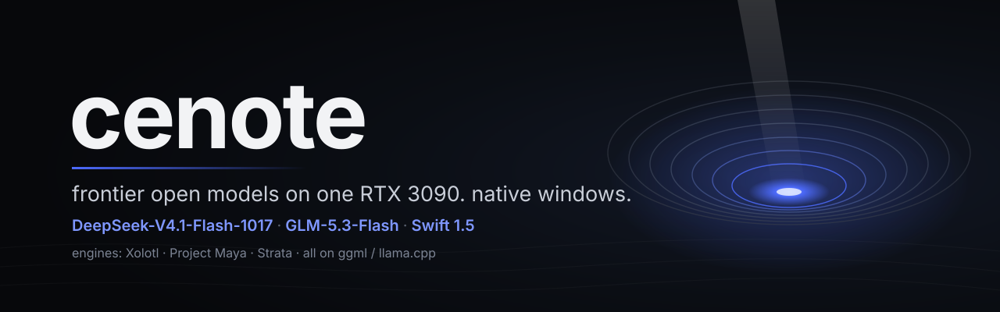
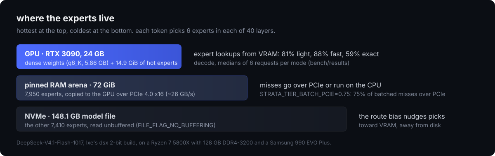

<p align="center">
  
</p>

<p align="center">
  <b>DeepSeek-V4.1-Flash-1017, GLM-5.3-Flash and Swift 1.5 on one RTX 3090 with 128 GB of RAM, natively on Windows 11.</b><br>
  The configs, launchers, test harness, raw results and lessons from one real rig.
</p>

<p align="center">
  <a href="https://github.com/Indras-Mirror/Xolotl/pull/10"></a>
  
  
  
  
</p>

## The stack

| Model | Quant | Engine | Port | Decode | Prompt reading |
| --- | --- | --- | --- | --- | --- |
| [DeepSeek-V4.1-Flash-1017](#deepseek-v41-flash-1017) | dsx 2-bit by lxe, 148.1 GB | [Xolotl](https://github.com/Indras-Mirror/Xolotl) | 8150 | **19.1 tok/s** light · 21.7 fast · 9.7 exact | 209.5 tok/s (13K prompt, September build) |
| [GLM-5.3-Flash](glm/README.md) | Maya-S24 by peasantsmith, 94.7 GB | [Project Maya](https://github.com/mw00/project-maya) 1.1.15 | 8090 | **16.9-17.8 tok/s** | 1,121 tok/s (115K prompt) |
| [Swift 1.5](qwen/README.md) (Qwen3.8-Flash-Next) | IQ3_S GSQ-RCO by ukisai, 83.7 GB | [Strata](https://github.com/Niko1221/Strata) 0.1.45 | 8080 | **92-102 tok/s** | 2,256 tok/s (16K prompt) |

One model at a time: each needs most of the GPU and between 59 and 93 GB of RAM. Method and raw data:
[docs/BENCHMARKS.md](docs/BENCHMARKS.md).

## What we built

The engines are other people's work (credits below). These parts are ours:

- **The Windows port of Xolotl's DeepSeek-V4.1 engine** (MSVC + CUDA, no WSL): overlapped unbuffered file I/O, aligned
  allocations, MSVC builds of the CPU kernels. Merged upstream as [Xolotl #10](https://github.com/Indras-Mirror/Xolotl/pull/10).
- **A Windows-only heap corruption, found and fixed.** Every DeepSeek prompt over 96 tokens crashed: MSVC's linker paired
  one library's CUDA template code with another library's smaller context struct. One define fixes it. Also #10.
- **Per-request routing modes** (`-fast`, light, `-exact` on one server, no restart), a **pool-window smart router** and
  a **route meter** that logs, for every request, how many expert picks differ from exact routing. Merged as
  [Xolotl #11](https://github.com/Indras-Mirror/Xolotl/pull/11), along with a bug the meter caught in our own toggle and
  a sync of DeepSeek's 1017 prompt encoder.
- **+19% decode from two settings** on the 3090 (72 GiB arena, 0.75 PCIe share; September build), found with a
  fresh-server sweep.
- **The 1017 setup:** a byte-exact shard merger for dsx GGUFs, an expert-rank converter, a 1017 DSpark draft built on
  Windows from the official checkpoint, and the tuned config.
- **A test method that holds up on a desktop PC:** one server, every mode switched per request, rotation and reverse.
  The harness and every raw result are in [bench/](bench/).
- **A Pi Desktop extension** that maps Pi's thinking levels to each local server and registers DeepSeek as a provider
  ([pi-desktop/](pi-desktop/)).

## DeepSeek-V4.1-Flash-1017

<p align="center"></p>

The model doesn't fit in VRAM, so Xolotl tiers its 15,360 routed experts across the GPU, a 72 GiB pinned RAM arena and
the NVMe. A routing nudge steers picks toward experts already in VRAM. That buys speed and costs fidelity, and the
route meter shows exactly how much:

| Model name | Mode | Avg tok/s | Prose / code / agent | Expert picks swapped vs exact |
| --- | --- | ---: | --- | ---: |
| `deepseek-v4.1-flash-xolotl` | light (0.25 / 0.15), the default | **19.1** | 15.9 / 22.4 / 19.1 | 26.1% |
| `deepseek-v4.1-flash-xolotl-fast` | fast (0.5 / 0.3) | 21.7 | 18.0 / 25.0 / 22.0 | 37.1% |
| `deepseek-v4.1-flash-xolotl-exact` | exact | 9.7 | 9.0 / 10.6 / 9.6 | 0% |

Light is the default because it keeps most of the speed and has a real quality score next to exact routing (Xolotl's
author: 85.2% vs 86.2% API top-1 at that strength). Every request logs its own reading:

```
serve: routing vs exact: 24.92% of expert picks swapped, 83.49% of router weight kept (1200 slots)
```

Per request over the API, without a restart:

```bash
curl http://127.0.0.1:8150/v1/chat/completions -H "Content-Type: application/json" -d '{
  "model": "deepseek-v4.1-flash-xolotl",
  "strata_tune": {"route_bias": 0.25, "route_bias_file": 0.15, "route_protect": 0, "route_pool": 0},
  "messages": [{"role": "user", "content": "hi"}]
}'
```

Setup: [deepseek/SETUP.md](deepseek/SETUP.md).

## Quick start

```bat
git clone --recurse-submodules https://github.com/vrami-dev/cenote D:\cenote
```

Then follow the page for the model you want: [DeepSeek](deepseek/SETUP.md) · [GLM](glm/README.md) · [Swift](qwen/README.md).
Start one with `scripts\start-deepseek.cmd`, `scripts\start-glm.cmd` or `scripts\start-swift.cmd`; each refuses to start
while another model is serving. `python scripts\stop-all.py` stops whichever one runs.

## What's in here

| Path | What |
| --- | --- |
| [deepseek/](deepseek/) | the tuned 1017 config and the setup guide |
| [glm/](glm/) | the Maya-S24 config and notes |
| [qwen/](qwen/) | the Swift configs (stock and SC117's abliterated) and notes |
| [scripts/](scripts/) | launchers, the one-model guard, `stop-all.py`, the expert-rank converter |
| [bench/](bench/) | the routing-modes harness and every raw result |
| [pi-desktop/](pi-desktop/) | the thinking-level extension and the DeepSeek provider block |
| [docs/](docs/) | [BENCHMARKS.md](docs/BENCHMARKS.md), [LESSONS.md](docs/LESSONS.md) |
| `engines/` | Xolotl, Strata and Project Maya as submodules, pinned to the versions measured here |

## Lessons

The short version of [docs/LESSONS.md](docs/LESSONS.md):
- The worst Windows bug was a linker detail, not CUDA.
- Decode on Windows is launch-bound; prompt reading is I/O-bound.
- The PC is the noise. Compare modes on one server, per request, in a balanced order.
- Build the meter first. It caught a bug the speed tests hid.
- "Fast mode" swapped 37% of DeepSeek's expert picks. Measure what a shortcut costs before making it the default.

## Credits

| Project | By | Used for |
| --- | --- | --- |
| [Xolotl](https://github.com/Indras-Mirror/Xolotl) | Indras Mirror | the DeepSeek-V4.1 engine and server |
| [Strata](https://github.com/Niko1221/Strata) | Niko1221 | the Swift / Qwen engine; the base Xolotl and Maya build on |
| [Project Maya](https://github.com/mw00/project-maya) | mw00 | the GLM-5.3-Flash engine |
| [ggml / llama.cpp](https://github.com/ggml-org/llama.cpp) | ggml-org | the kernels under all three |
| [DeepSeek-V4.1-Flash-1017](https://huggingface.co/deepseek-ai/DeepSeek-V4.1-Flash-1017) | DeepSeek | the model and its prompt encoder |
| [dsx 2-bit](https://huggingface.co/lxe/DeepSeek-V4.1-Flash-1017-dsx-2bit) | lxe | the DeepSeek quant and expert ranking |
| [1017 XQ build](https://huggingface.co/IndrasMirror/DeepSeek-V4.1-Flash-1017-XQ-Uncensored) | IndrasMirror | the 1017 DSpark draft and tokenizer files |
| [GLM-5.3-Flash](https://huggingface.co/zai-org/GLM-5.3-Flash) | Zhipu AI | the model |
| [Maya quants](https://huggingface.co/peasantsmith/GLM-5.3-Flash-Maya-GGUF) | peasantsmith | Maya-S24 |
| [Qwen3.8-Flash-Next](https://huggingface.co/Qwen/Qwen3.8-Flash-Next) | Qwen | the base model |
| [Swift 1.5](https://huggingface.co/ukisai/Swift-1.5-Qwen3.8-Flash-Next-GSQ-RCO-GGUF) | UkisAI | the fine-tune and its IQ3_S quant |
| [Swift 1.5 abliterated](https://huggingface.co/SC117/Swift-1.5-Qwen3.8-Flash-Next-GSQ-RCO-abliterated-GGUF) | SC117 | the uncensored variant |
| [colibri](https://github.com/JustVugg/colibri) | JustVugg | the pool-window routing rule |
| [arXiv:2412.00099](https://arxiv.org/abs/2412.00099) | Qualcomm AI Research | cache-aware routing, the reference for the next step |
| [Pi](https://github.com/badlogic/pi-mono) | badlogic | the agent behind Pi Desktop |

## License

MIT for everything in this repo ([LICENSE](LICENSE)). The engines in `engines/` are MIT under their own notices; the
models and quants keep the licenses on their cards.

<p align="center"><sub>one rig, real numbers. maintained by <a href="https://x.com/vrami_dev">vrami</a>.</sub></p>
